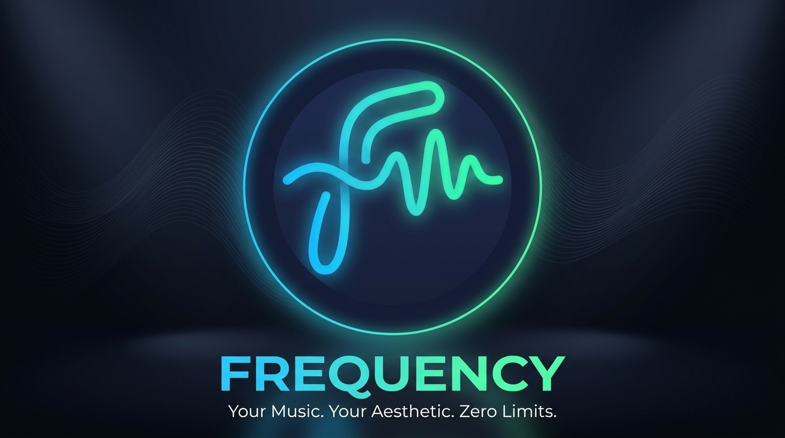
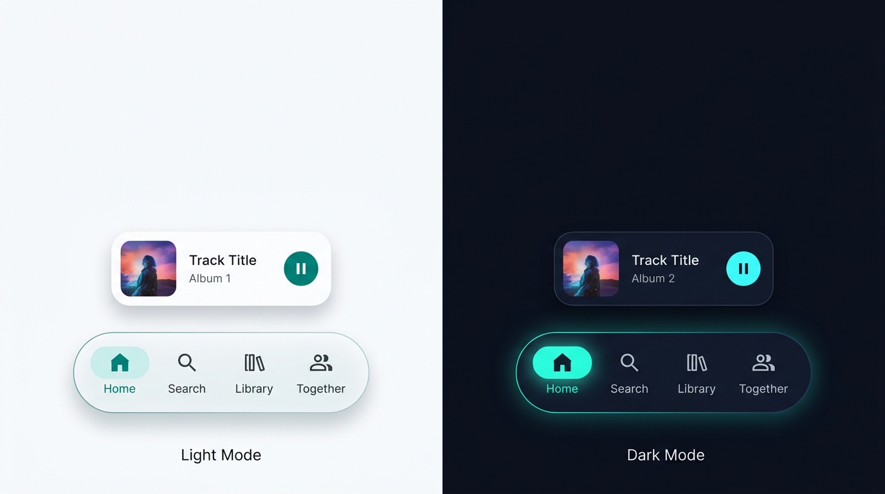
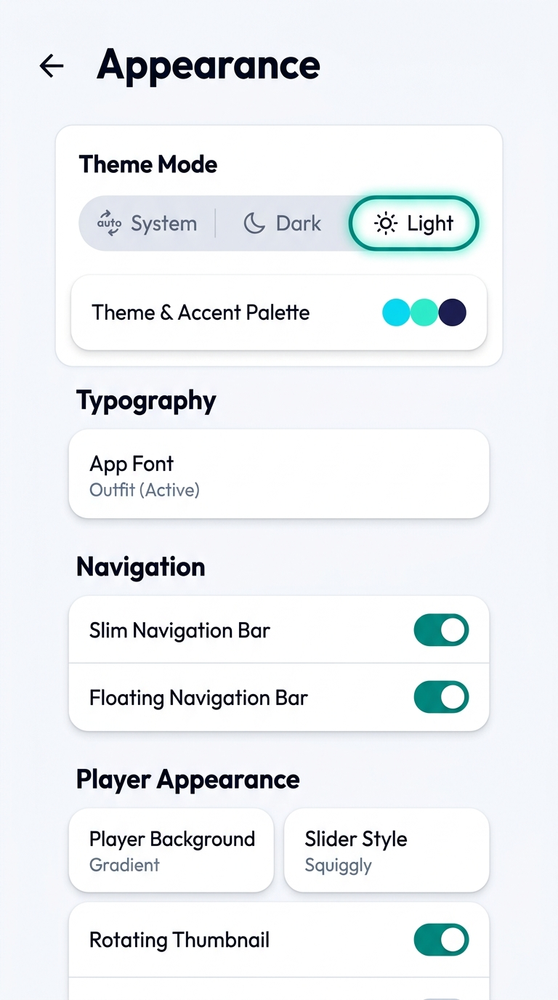
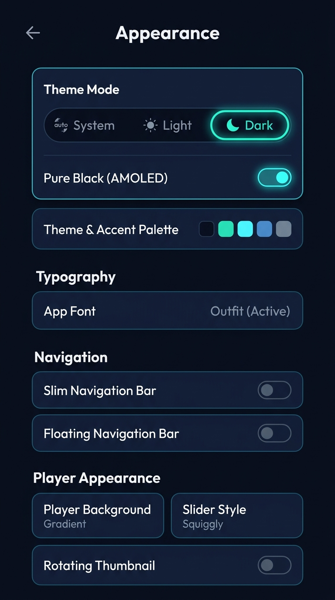

  
   
  <h1>Frequency</h1>
  <h3>More Than Just Music — Your Ultimate Audio Experience</h3>

  

    
    
    
  

<h2>🎵 About Frequency</h2>

<table align="center" width="100%">
  <tr valign="middle">
    <td width="60%" align="left">
      
✨ <b>Frequency</b> is a high-performance, open-source audio streaming ecosystem engineered for listeners who crave both acoustic purity and visual elegance. Built around the tactile <b>Sonic Dock</b> and a dynamic dual-mode <b>Luminous & Obsidian</b> theme engine, Frequency breathes alongside your music — shifting colors to match your playing album art while delivering seamless, ad-free streaming from YouTube Music.

      
From word-by-word synchronized karaoke lyrics and high-fidelity parametric DSP equalization to animated canvas backdrops, every detail is crafted to elevate your listening without weighing down your device. Engineered with strict memory discipline to stay buttery smooth on any hardware (from flagship OLED displays to 2GB budget phones), Frequency gives you complete freedom with a 100% local database, zero subscription paywalls, and absolutely no tracking or background telemetry.

      <blockquote>
        <b>🎵 Your music, your aesthetic, zero limits — tuned to your frequency.</b>
      </blockquote>
    </td>
    <td width="40%" align="center">
      
🛡️ <b>100% Privacy & Local</b> <small>Completely offline database. Absolutely zero trackers, analytics, or background telemetry.</small>

      

      
🎨 <b>Dual-Mode & Sonic Dock</b> <small>Tactile floating acoustic navigation capsule with Luminous Light & Obsidian Dark themes.</small>

      

      
🚀 <b>Ad-Free Streaming</b> <small>High-fidelity background playback with infinite streams from YouTube Music.</small>

      

      
⚡ <b>Low-RAM Optimization</b> <small>Engineered to stay buttery smooth and lightweight on budget 2GB–4GB devices.</small>

    </td>
  </tr>
</table>

<h2>📸 Design & Interface Showcase</h2>

<table align="center">
  <tr valign="top">
    <td align="center">
      <b>The Sonic Dock Capsule</b>  
      
    </td>
    <td align="center">
      <b>Luminous Light Mode</b>  
      
    </td>
    <td align="center">
      <b>Obsidian Dark Mode</b>  
      
    </td>
  </tr>
</table>

<h2>✨ Features</h2>

<table align="center" width="100%">
  <tr valign="top">
    <td width="50%">
      <h3>🎨 Expressive UI & Design</h3>
      <ul>
        <li><b>Dual-Mode Aesthetics:</b> Full support for Luminous Light Mode, Obsidian Dark Mode, and Pure Black AMOLED.</li>
        <li><b>The Sonic Dock:</b> Redesigned unified floating acoustic navigation capsule with tactile micro-motion.</li>
        <li><b>Dynamic Material You:</b> Beautiful adaptive colors that shift to match your playing album art.</li>
        <li><b>Low-End Device Optimization:</b> Engineered to stay buttery smooth and RAM-efficient on budget hardware (2GB–4GB RAM).</li>
      </ul>
    </td>
    <td width="50%">
      <h3>🎵 Advanced Streaming</h3>
      <ul>
        <li><b>Full Catalog Integration:</b> Stream any song from YouTube and YT Music, completely ad-free.</li>
        <li><b>Animated Canvas:</b> Stunning Apple Music-style animated backdrops that bring music to life.</li>
        <li><b>Background Playback:</b> High-quality continuous playback with full notification drawer controls.</li>
      </ul>
    </td>
  </tr>
  <tr valign="top">
    <td width="50%">
      <h3>📝 Synced Lyrics & Audio</h3>
      <ul>
        <li><b>Karaoke Syncing:</b> Beautiful, precise word-by-word highlighted lyrics.</li>
        <li><b>Integrated EQ:</b> High-fidelity audio customization with an in-app Equalizer.</li>
      </ul>
    </td>
    <td width="50%">
      <h3>📥 Offline Experience</h3>
      <ul>
        <li><b>Local Downloads:</b> Download and cache tracks onto your device for offline enjoyment.</li>
        <li><b>Smart Storage:</b> Intelligent cache management that optimizes space automatically.</li>
      </ul>
    </td>
  </tr>
  <tr valign="top">
    <td width="50%">
      <h3>🔄 Built-in OTA Updater</h3>
      <ul>
        <li><b>Seamless Updates:</b> Instant Over-the-Air updates directly inside the app powered by GitHub Releases.</li>
        <li><b>Direct Delivery:</b> Always stay ahead with instant feature upgrades and patch fixes.</li>
      </ul>
    </td>
    <td width="50%">
      <h3>🛡️ 100% Privacy</h3>
      <ul>
        <li><b>Zero Data Collection:</b> No trackers, no telemetry, and no telemetry analytics.</li>
        <li><b>Local Security:</b> All user libraries, preferences, and downloaded tracks are stored locally.</li>
      </ul>
    </td>
  </tr>
</table>

 

<h2>🚗 Android Auto Setup</h2>

If Frequency doesn't appear in Android Auto:

<ol>
  <li>Open <strong>Android Auto</strong> on your phone</li>
  <li>Tap the <strong>hamburger menu</strong> (three lines) and go to <strong>Settings</strong></li>
  <li>Scroll to the bottom and tap the <strong>version number</strong> multiple times to enable Developer Settings</li>
  <li>Tap the <strong>three dots menu</strong> (⋮) at the top-right</li>
  <li>Select <strong>Developer settings</strong></li>
  <li>Enable <strong>Unknown sources</strong></li>
  <li>Restart Android Auto and connect to your car</li>
</ol>

<h2>🤝 Contributing</h2>

Contributions are welcome! Whether it's bug reports, feature requests, or code contributions:

<ol>
  <li>Fork the repository</li>
  <li>Create your feature branch (<code>git checkout -b feature/AmazingFeature</code>)</li>
  <li>Commit your changes (<code>git commit -m 'Add some AmazingFeature'</code>)</li>
  <li>Push to the branch (<code>git push origin feature/AmazingFeature</code>)</li>
  <li>Open a Pull Request</li>
</ol>

<h2>🛡️ Privacy & Data Collection</h2>

At <strong>Frequency</strong>, your privacy is our top priority. We believe that your music and data belong exclusively to you.

<ul>
  <li><strong>Zero Data Collection:</strong> We do <strong>not</strong> collect, store, or share any of your personal information, usage habits, or listening history.</li>
  <li><strong>100% Local:</strong> All your settings, downloaded tracks, and offline caches are stored securely on your device.</li>
  <li><strong>No Tracking:</strong> There are no hidden trackers, analytics, or background services monitoring your activity.</li>
</ul>

Enjoy your music with complete peace of mind, knowing that your privacy is fully protected.

<h2>📜 Disclaimer</h2>

This project and its contents are <strong>not affiliated with, funded, authorized, endorsed by, or in any way associated with</strong> YouTube, Google LLC, or any of their affiliates and subsidiaries.

Any trademark, service mark, trade name, or other intellectual property rights used in this project are owned by their respective owners.

<strong>Frequency</strong> is an independent project created for educational and personal use purposes.

<h2>📄 License & Guidelines</h2>

This project is licensed under the terms specified in the <a href="LICENSE">LICENSE</a> (GPL-3.0) file.

If you copy, adapt, or reuse any part of the source code, you must adhere to the guidelines outlined in the <a href="rules.md">rules.md</a> file.

  <table border="0" cellpadding="15" cellspacing="0" width="85%">
    <tr>
      <td align="center">
        <h3>💬 Community & Support</h3>
        
Connect with other music lovers, suggest new features, report bugs, and stay updated with the latest releases!

         
        
          <a href="https://github.com/daveans1/frequency/issues">🐞 Report Bugs</a> &nbsp;•&nbsp;
          <a href="https://github.com/daveans1/frequency/discussions">💬 Discussions</a> &nbsp;•&nbsp;
          <a href="https://github.com/daveans1/frequency/releases">🚀 Releases</a>
        
      </td>
    </tr>
  </table>

  <h2>🙏 Special Thanks & Credits</h2>

  
Frequency is built upon the foundation of incredible open-source projects and developers:

   

  <table border="0" cellpadding="10" cellspacing="0" width="90%">
    <tr valign="top">
      <td width="40%" align="left">
        <b>💡 Upstream Lineage</b>
        <ul>
          <li><strong><a href="https://github.com/vivimusicGroup/vivimusic">ViVi Music</a></strong> – For the rich foundation, visual style, and extensive UI polish.</li>
          <li><strong><a href="https://github.com/mostafaalagamy/metrolist">Metrolist</a></strong> – The pioneering open-source player that started it all.</li>
          <li><strong><a href="https://github.com/ZemerTeam/zemer-cipher">@Zemer</a></strong> – For audio streaming and cipher playback methods.</li>
        </ul>
      </td>
      <td width="60%" align="left">
        <b>🎖️ Foundational Projects & Providers</b>
        <ul>
          <li><strong><a href="https://github.com/better-lyrics/better-lyrics">Better Lyrics</a></strong> – For beautiful synced lyrics and YouTube Music integration.</li>
          <li><strong><a href="https://github.com/maxrave-dev/SimpMusic">SimpMusic</a></strong> – For lyrics functionality and integration logic.</li>
          <li><strong><a href="https://github.com/ibratabian17/YouLyPlus">YouLyPlus</a></strong> – For smooth in-app lyrics styling.</li>
          <li><strong><a href="https://github.com/monochrome-music/monochrome">Monochrome</a></strong> – For the Apple Music-style visualizer canvas.</li>
        </ul>
      </td>
    </tr>
  </table>

   
  
Thank you to all the amazing open-source developers who made this project possible!

  

  
<strong>Made with ❤️ for music lovers everywhere</strong>

  
⭐ Star this repo if you enjoy Frequency!

